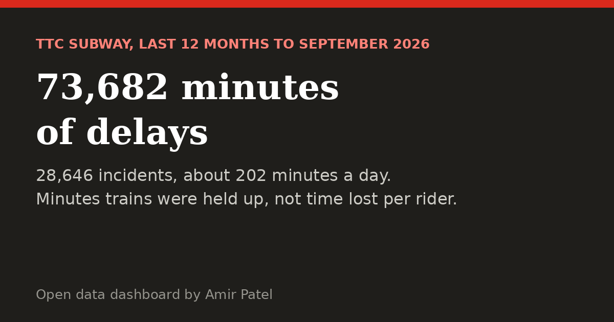
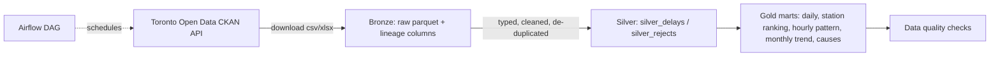

# TTC Subway Delay Pipeline

An end-to-end data engineering project on **Toronto Open Data**: it ingests the City of Toronto's TTC subway delay
files, cleans and models them with **DuckDB SQL**, validates them with automated **data-quality checks**, and
exposes analytics tables that answer questions like *which stations lose the most rider minutes?*

> Status: **built in public over 3 days.** The pipeline runs on the real Toronto data, loads are incremental, the schema has a data contract, the Airflow DAG is tested, and a public dashboard is rebuilt daily from the City's open data.
>
> **Live dashboard:** https://amirpatel32003.github.io/ttc-delay-pipeline/

[](https://amirpatel32003.github.io/ttc-delay-pipeline/)

## Architecture



| Layer | What happens | Tables / files |
|---|---|---|
| Bronze | Download as published, all text, add `_source` and `_ingested_at` | `data/bronze/*.parquet` |
| Silver | Cast types, standardise station and line names, drop duplicates, route bad rows to a rejects table with a reason | `silver_delays`, `silver_rejects` |
| Gold | Business-ready aggregates | `gold_daily_summary`, `gold_station_ranking`, `gold_hourly_pattern`, `gold_monthly_trend`, `gold_cause_breakdown` |
| Quality | 9 automated checks (nulls, ranges, duplicates, reject rate, unknown-line rate, gold = silver reconciliation) | `ttc_pipeline/quality.py` |
| Ledger | One row per source file: `last_modified`, SHA-256, rows, bytes | `ingestion_log` table, `data/bronze/_manifest.json` |

## Run it

```bash
pip install -r requirements.txt
export PYTHONPATH=src                     # Windows PowerShell: $env:PYTHONPATH="src"

python -m ttc_pipeline.cli run --sample   # offline demo on bundled synthetic data (separate bronze + warehouse)
python -m ttc_pipeline.cli run            # real data from Toronto Open Data, incremental
python -m ttc_pipeline.cli run --force    # ignore the ledger and re-download everything
python -m ttc_pipeline.cli docs           # regenerate docs/schema.md and docs/data_contract.md
pytest -q
```

## Results on the real data

Measured on the live Toronto Open Data package `ttc-subway-delay-data` (run on 2026-11-07):

| Metric | Value |
|---|---|
| Source files loaded | 10 (yearly files 2014 to 2024 plus the "since 2025" file) |
| Source rows | 270,282 |
| Exact duplicates removed | 275 |
| Rows in `silver_delays` | 270,007 (2014-01-01 to 2026-09-30, every month present) |
| Rows rejected | 0 |
| Gold stations ranked | 920 |
| First full ingest | about 17 s |
| Second run (nothing changed) | all 10 files skipped without a download |
| Tests | 43 pass locally, 1 Airflow import test runs in the CI `dag` job |

What the real data taught me (each one is now a fix plus a regression test):

- The portal publishes the "since 2025" data four times (datastore XLSX dump, CSV, XML, JSON). The ingest keeps one resource per dataset and prefers CSV.
- The line column has many spellings (`YU/BD`, `YUS`, `BLOOR DANF`, `YU / BD`) and a few junk values (`999`, `60`). They collapse to `YU`, `BD`, `SHP`, `SRT`, `YU/BD` or `OTHER`. Blank or `OTHER` stays below 0.4% of rows.
- Station names are truncated at 20 characters (`KIPLING STATION (ENTER`) and carry line qualifiers (`KENNEDY BD`, `KENNEDY SRT`). About 13,400 rows name a track segment or a whole line instead of a station, so they are flagged `is_station = FALSE` and left out of the station ranking.
- 29 delay codes (1,867 incidents) are not in the current code lookup even after filling from the legacy 2022 workbook; they show as "Unknown code".
- The 2017-2021 files are Excel workbooks with one sheet per month. My first loader read only the first sheet, so the warehouse silently held January of 2018-2021 and May of 2017 and looked as if the City had published almost nothing. The dashboard exposed it. The loader now reads every sheet, the ingest ledger records a parser version so already-loaded files are reprocessed, and a test builds a multi-sheet workbook. A check for every month from 2014 to 2026 now finds none missing.
- About two thirds of rows have `min_delay = 0`, so delay averages are reported next to `delay_incidents`.

Top station by total delay minutes in this data: KENNEDY (12,637 incidents, 33,520 minutes).

## Incremental loading

Each CKAN resource is recorded in a ledger with its `last_modified` and the SHA-256 of the bytes. On the next run a resource whose `last_modified` is unchanged is skipped without a download. One that was re-published with identical bytes is downloaded but not rewritten. A deleted bronze file is restored. The ledger is exposed as the `ingestion_log` table.

## Documentation

- [`docs/data_contract.md`](docs/data_contract.md): owners, SLAs, column types and rules, known data issues. Rendered from `src/ttc_pipeline/contract.py`.
- [`docs/schema.md`](docs/schema.md): generated from the DuckDB catalog, with row counts from the real warehouse. A test fails if the contract and the catalog drift apart.

## Orchestration

`dags/ttc_daily_dag.py` runs ingest, build and check daily. Its structure is tested with pytest (task order, CLI steps, settings) and a CI job installs Airflow 2.10.5 and imports it through `DagBag`. Honest status: it has not been run on a live Airflow scheduler yet, and the real-data run happens on my machine, because CI only has the bundled sample.

## Tech
Python · DuckDB · pandas · PyArrow · SQL · pytest · GitHub Actions · Apache Airflow (DAG)

## Roadmap
- [x] Day 1: bronze/silver/gold, quality checks, tests, CI
- [x] Day 2: real data run, incremental loads, data contract and schema docs, Airflow DAG tested
- [x] Day 3: public dashboard with real findings (plain-English view, phone layout, downloadable PDF), final README write-up

Data: [City of Toronto Open Data - TTC Subway Delay Data](https://open.toronto.ca/dataset/ttc-subway-delay-data/), Open Government Licence - Toronto.
