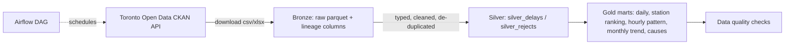

# TTC Subway Delay Pipeline

An end-to-end data engineering project on **Toronto Open Data**: it ingests the City of Toronto's TTC subway delay
files, cleans and models them with **DuckDB SQL**, validates them with automated **data-quality checks**, and
exposes analytics tables that answer questions like *which stations lose the most rider minutes?*

> Status: **work in progress, built in public.** Day 1 of 3: ingestion, warehouse, quality checks, tests and CI.

## Architecture



| Layer | What happens | Tables / files |
|---|---|---|
| Bronze | Download as published, all text, add `_source` and `_ingested_at` | `data/bronze/*.parquet` |
| Silver | Cast types, standardise station and line names, drop duplicates, route bad rows to a rejects table with a reason | `silver_delays`, `silver_rejects` |
| Gold | Business-ready aggregates | `gold_daily_summary`, `gold_station_ranking`, `gold_hourly_pattern`, `gold_monthly_trend`, `gold_cause_breakdown` |
| Quality | 8 automated checks (nulls, ranges, duplicates, reject rate, gold = silver reconciliation) | `ttc_pipeline/quality.py` |

## Run it

```bash
pip install -r requirements.txt
export PYTHONPATH=src                     # Windows PowerShell: $env:PYTHONPATH="src"

python -m ttc_pipeline.cli run --sample   # offline demo on bundled synthetic data
python -m ttc_pipeline.cli run            # real data from Toronto Open Data
pytest -q
```

## Tech
Python · DuckDB · pandas · PyArrow · SQL · pytest · GitHub Actions · Apache Airflow (DAG)

## Roadmap
- [x] Day 1: bronze/silver/gold, quality checks, tests, CI
- [ ] Day 2: incremental loads, Airflow DAG tested, data contract / schema documentation
- [ ] Day 3: dashboard with real findings, performance notes, final README write-up

Data: [City of Toronto Open Data - TTC Subway Delay Data](https://open.toronto.ca/dataset/ttc-subway-delay-data/), Open Government Licence - Toronto.
